# BẢN THIẾT KẾ HỆ THỐNG (SYSTEM DESIGN DRAFT v2.0 — CHUẨN PTIT)
**Đề tài:** Hệ thống Thương mại Điện tử Thời trang tích hợp Tìm kiếm Đa phương thức, AI Stylist Cá nhân hóa & Thử đồ trực tiếp (Wearson AI)  
**Cấu trúc chuẩn:** Bám sát 100% khung phương pháp luận môn *Phân tích và Thiết kế Hệ thống Thông tin — PTIT* (`tt_nhichu.pdf`) và danh mục yêu cầu tại **Ảnh 1**.

> [!IMPORTANT]
> **Các quy tắc cốt lõi đã chuẩn hóa trong bản v2.0 này:**
> 1. **Actor chỉ là người thực:** Chỉ gồm 2 Actor con người là **`Customer`** và **`Admin`** (Tuyệt đối không đưa các dịch vụ AI hay hệ thống kỹ thuật làm Actor).
> 2. **Đầy đủ bộ FR1–FR12 theo Ảnh 1 + Mở rộng AI Stylist & Wearson AI:** Bao gồm cả chức năng gõ mã đơn vào thanh tìm kiếm để tra cứu đơn hàng (`FR6`, `FR7`), cơ chế tự động **nới lỏng bộ lọc (Relax Hard Filter $\rightarrow$ Soft Preference)** khi có ít hơn 3 kết quả, và 3 chức năng quản trị của Admin (`FR9`, `FR10`, `FR11`).
> 3. **Đủ toàn bộ quy trình & biểu đồ như `tt_nhichu.pdf`:** Kịch bản chuẩn & ngoại lệ $\rightarrow$ Activity Diagram $\rightarrow$ 5 bước trích Entity Class $\rightarrow$ Analysis Class Diagram (Entity + View `in/out/sub` + Control + 4 câu hỏi gán hàm) $\rightarrow$ Sequence Phân tích $\rightarrow$ Kiến trúc 3 Layer & 4 Package (`interface`, `controller`, `DAO`, `model`) $\rightarrow$ 4 bước thiết kế Entity $\rightarrow$ 5 bước thiết kế CSDL & ERD $\rightarrow$ Design Class Diagram (kèm Interface Realization) $\rightarrow$ Sequence Thiết kế $\rightarrow$ Ma trận ánh xạ Code.

---

# PHẦN I: YÊU CẦU HỆ THỐNG (REQUIREMENTS)

## 1. Mô tả hệ thống bằng ngôn ngữ tự nhiên

### 1.1. Tổng quan
Hệ thống **MaisonAI (SmartFashion)** là một website thương mại điện tử bán lẻ thời trang trực tuyến, cho phép khách hàng tìm kiếm sản phẩm bằng **từ khóa văn bản**, **giọng nói** hoặc **hình ảnh**, đồng thời cung cấp **AI Stylist cá nhân hóa** giúp phân tích vóc dáng từ ảnh chụp trực tiếp, thu thập mong muốn (qua bộ câu hỏi mẫu hoặc nói qua micro), tự động phối nhiều bộ trang phục (**Costumes/Outfits**) từ kho hàng và ướm thử trực tiếp lên người dùng thông qua **Wearson AI**.

### 1.2. Các Actor (Chỉ gồm con người thực)

| STT | Actor | Vai trò | Chức năng chính |
|---|---|---|---|
| 1 | **Customer** | Khách mua hàng | Đăng nhập/đăng xuất, tìm sản phẩm bằng từ khóa/giọng nói/hình ảnh, nhận kết quả xếp hạng theo độ phù hợp, sử dụng AI Stylist phối đồ & thử đồ trực tiếp (Wearson AI), xem chi tiết sản phẩm, quản lý giỏ hàng, thanh toán đơn hàng, tìm kiếm và xem chi tiết đơn hàng. |
| 2 | **Admin** | Quản trị viên | Đăng nhập/đăng xuất, quản lý sản phẩm (thêm/sửa/xóa/tồn kho), quản lý danh mục (cây danh mục cha-con), quản lý và cập nhật trạng thái đơn hàng. |

### 1.3. Bảng Yêu cầu Chức năng (Chuẩn hóa theo Ảnh 1 + Mở rộng AI Stylist)

#### A. Nhóm Actor: `Customer` (Khách mua hàng)
| Mã FR | Tên tiếng Việt | Tên Use Case tiếng Anh | Mô tả chi tiết |
|---|---|---|---|
| **FR1** | Tìm sản phẩm bằng từ khóa | `Search by Keyword` | Nhập câu mô tả tự nhiên (VD: *"áo sơ mi trắng dưới 1.5 triệu"*); hệ thống bóc tách hard filter (danh mục, màu, giá) và soft preference (phong cách, mùa, chất liệu). |
| **FR2** | Tìm sản phẩm bằng giọng nói | `Search by Voice` | Bật micro hoặc dùng phím tắt Mumble Voice (`Ctrl + Space`) để nói yêu cầu bằng tiếng Việt; hệ thống chuyển thành chữ rồi tìm kiếm. |
| **FR3** | Tìm sản phẩm bằng hình ảnh | `Search by Image` | Tải ảnh trang phục lên (có thể chọn vùng trang phục trên ảnh hoặc dùng toàn ảnh) để tìm sản phẩm có đặc trưng hình ảnh giống nhất. |
| **FR4** | Xếp hạng kết quả theo độ phù hợp | `Search Product` | Use case tổng quát kết hợp lọc cứng (hard filter), nới lỏng filter nếu `< 3` kết quả, tìm trên `KeywordIndex` & `VectorIndex`, xếp hạng kèm nhãn giải thích. |
| **FR5** | Xem chi tiết sản phẩm | `View Product` | Xem ảnh, giá, màu sắc, kích cỡ, chất liệu, số lượng tồn kho và các thông tin bảo quản của sản phẩm. |
| **FR6** | Tìm kiếm đơn hàng | `Search Order` | Nhập mã đơn hàng (VD: `SF-2026-0038`) trực tiếp vào ô tìm kiếm hoặc khung tra cứu để tìm nhanh đơn hàng. |
| **FR7** | Xem chi tiết đơn hàng | `View Order` | Xem danh sách sản phẩm đã đặt, số lượng, đơn giá lúc mua, phí vận chuyển, tổng tiền và trạng thái xử lý của đơn hàng. |
| **FR8** | Thanh toán đơn hàng | `Make Payment` | Điền thông tin giao nhận, chọn phương thức thanh toán (COD / VNPay / MoMo), kiểm tra & trừ tồn kho để tạo đơn hàng. |
| **FR13** *(Mở rộng)* | Tư vấn phối đồ cùng AI Stylist | `Consult AI Stylist` | Khách chụp ảnh trực tiếp (hoặc tải ảnh toàn thân), sau đó trả lời **3–4 câu hỏi có phương án mẫu** HOẶC **bật mic nói tự do**; AI phân tích vóc dáng + mong muốn để phối **2–3 bộ Costume** từ sản phẩm trong shop. |
| **FR14** *(Mở rộng)* | Thử đồ trực tiếp với Wearson AI | `Virtual Try-On Costume` | Chọn một bộ Costume (hoặc món đồ) vừa được AI phối để **Wearson AI** ghép trực tiếp lên bức ảnh của khách hàng. |

#### B. Nhóm Actor: `Admin` (Quản trị viên)
| Mã FR | Tên tiếng Việt | Tên Use Case tiếng Anh | Mô tả chi tiết |
|---|---|---|---|
| **FR9** | Quản lý sản phẩm | `Manage Product` | Thêm mới, cập nhật thông tin, giá bán, biến thể màu/size và điều chỉnh số lượng tồn kho sản phẩm. |
| **FR10** | Quản lý danh mục | `Manage Category` | Thêm mới, sửa, xóa và tổ chức cấu trúc cây danh mục cha – danh mục con. |
| **FR11** | Quản lý đơn hàng | `Manage Order` | Xem danh sách đơn đặt hàng, lọc theo trạng thái và cập nhật tiến trình đơn (`Mới tạo` $\rightarrow$ `Đã xác nhận` $\rightarrow$ `Đang giao` $\rightarrow$ `Hoàn tất`). |

#### C. Dùng chung cho cả hai Actor (`Customer` & `Admin`)
| Mã FR | Tên tiếng Việt | Tên Use Case tiếng Anh | Mô tả chi tiết |
|---|---|---|---|
| **FR12** | Đăng nhập, đăng xuất | `Login · Logout` | Xác thực tài khoản theo phân quyền (`customer` hoặc `admin`) và đăng xuất khỏi phiên làm việc. |

---

## 2. Biểu đồ Use Case (Use Case Diagrams)

### 2.1. Use Case Diagram 1 — Tổng quát toàn hệ thống
Chỉ đặt **2 Actor con người (`Customer` và `Admin`)** quanh System Boundary `SmartFashion E-Commerce System`:

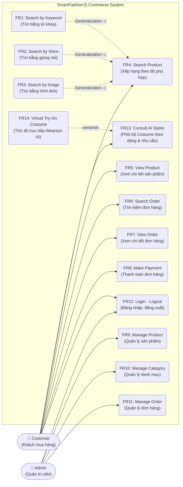

### 2.2. Use Case Diagram 2 — Đi sâu Module Tìm kiếm & AI Stylist Phối đồ

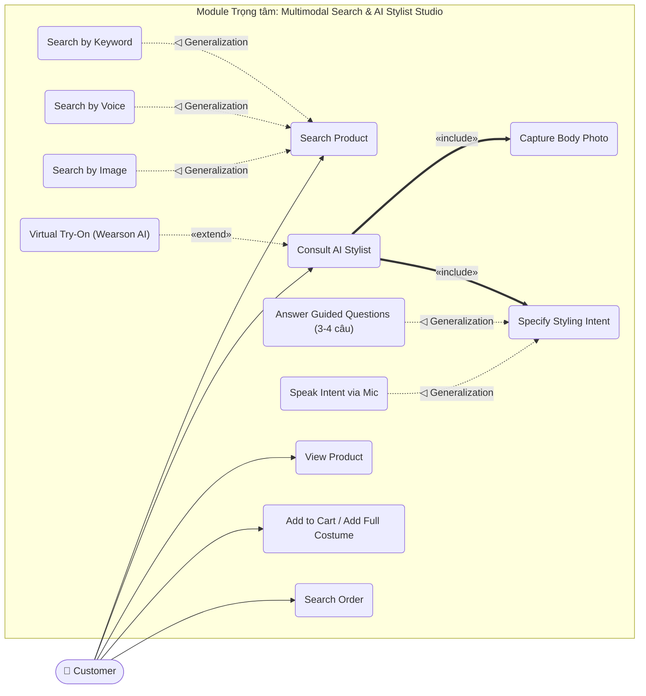

### 2.3. Bảng Mô tả các Use Case (Chuẩn câu mô tả PTIT)

| Tên Use Case | Mô tả chuẩn ("Use case này cho phép...") |
|---|---|
| **Search Product (FR4)** | Use case này cho phép `Customer` tìm sản phẩm theo nhu cầu và nhận danh sách sản phẩm đã xếp hạng theo độ phù hợp kèm nhãn giải thích. |
| **Search by Keyword (FR1)** | Use case này cho phép `Customer` gõ câu mô tả tự nhiên để lọc cứng (danh mục, màu, giá) và xếp hạng sản phẩm phù hợp nhất. |
| **Search by Voice (FR2)** | Use case này cho phép `Customer` nói yêu cầu qua micro (Mumble Voice/Web Speech), hệ thống chuyển giọng nói thành văn bản tiếng Việt rồi tìm sản phẩm. |
| **Search by Image (FR3)** | Use case này cho phép `Customer` tải ảnh lên (chọn vùng trang phục hoặc toàn ảnh) để tìm sản phẩm có đặc trưng hình ảnh giống nhất. |
| **Consult AI Stylist (FR13)** | Use case này cho phép `Customer` chụp ảnh cơ thể và chia sẻ mong muốn (qua 3–4 câu hỏi mẫu hoặc nói qua mic) để AI phân tích vóc dáng và phối nhiều bộ Costume từ kho hàng. |
| **Virtual Try-On Costume (FR14)** | Use case này cho phép `Customer` ướm thử trực tiếp bộ Costume hoặc sản phẩm đã chọn lên bức ảnh cơ thể của mình bằng Wearson AI. |
| **View Product (FR5)** | Use case này cho phép `Customer` xem thông tin chi tiết, biến thể màu/size và tồn kho của một sản phẩm. |
| **Search Order (FR6)** | Use case này cho phép `Customer` nhập mã đơn hàng vào thanh tìm kiếm hoặc ô tra cứu để tìm nhanh đơn hàng của mình. |
| **View Order (FR7)** | Use case này cho phép `Customer` xem chi tiết trạng thái, danh sách món đồ và tổng tiền của đơn hàng. |
| **Make Payment (FR8)** | Use case này cho phép `Customer` đặt mua các sản phẩm trong giỏ và thực hiện thanh toán đơn hàng. |
| **Manage Product (FR9)** | Use case này cho phép `Admin` thêm mới, chỉnh sửa thông tin và cập nhật số lượng tồn kho của sản phẩm. |
| **Manage Category (FR10)** | Use case này cho phép `Admin` tạo và quản lý danh mục sản phẩm theo cấu trúc cha – con. |
| **Manage Order (FR11)** | Use case này cho phép `Admin` theo dõi và cập nhật trạng thái xử lý của các đơn đặt hàng. |
| **Login · Logout (FR12)** | Use case này cho phép `Customer` và `Admin` đăng nhập vào hệ thống theo phân quyền và đăng xuất khi kết thúc phiên. |

---

# PHẦN II: PHÂN TÍCH HỆ THỐNG (SYSTEM ANALYSIS)

## 1. Xây dựng Kịch bản (Scenarios)

### 1.1. Kịch bản 1 (Chuẩn): Tìm sản phẩm bằng từ khóa (`FR1`, `FR4`, `FR5`)
1. **Khách hàng A** mở trang chủ để tìm mua một chiếc áo sơ mi.
2. **Hệ thống** hiển thị giao diện trang chủ gồm: ô tìm kiếm, nút micro, nút tải ảnh, nút Tìm và thanh danh mục.
3. **A** nhập câu *"áo sơ mi trắng dưới 2 triệu"* và nhấn nút Tìm.
4. **Hệ thống** phân tích câu, hiển thị các điều kiện đã hiểu (**Hard filters:** Danh mục = `Áo`, Màu = `Trắng`, Giá `< 2.000.000₫`), số lượng sản phẩm thỏa mãn và danh sách kết quả đã sắp xếp theo độ khớp kèm nhãn giải thích (VD: `Đúng danh mục Áo`, `Khớp màu trắng`, `Trong tầm giá`).
5. **A** nhấn vào sản phẩm đứng đầu danh sách (*"Sơ mi Linen Form Rộng"*).
6. **Hệ thống** hiển thị giao diện chi tiết sản phẩm gồm: bộ ảnh, giá bán, bảng màu, các kích cỡ (`XS, S, M, L`), trạng thái còn hàng và nút **Thêm vào túi**.
7. **A** chọn size `M` và nhấn **Thêm vào túi**.
8. **Hệ thống** cập nhật giỏ hàng và mở ngăn túi đồ thông báo đã thêm thành công.

### 1.2. Kịch bản 2: Tìm bằng giọng nói (`FR2`) và Tìm bằng hình ảnh (`FR3`)
*Chỉ khác kịch bản chuẩn ở **bước 3** và **bước 4**, các bước 5–8 giữ nguyên:*
- **Nhánh Giọng nói (`Search by Voice`):**
  - **Bước 3:** A nhấn nút Micro (hoặc giữ `Ctrl + Space` với Mumble Voice) và nói *"tôi muốn tìm blazer xám mặc đi làm"*.
  - **Bước 3a:** Hệ thống chuyển giọng nói thành văn bản *"tôi muốn tìm blazer xám mặc đi làm"* và điền vào ô tìm kiếm.
  - **Bước 4:** Hệ thống hiểu Hard filter (`Danh mục = Áo khoác`, `Màu = Xám`) và Soft preference (`Dịp = Công sở`), trả về các mẫu Blazer đứng đầu.
- **Nhánh Hình ảnh (`Search by Image`):**
  - **Bước 3:** A nhấn nút Tải ảnh và chọn một bức ảnh chụp street-style gồm áo khoác và quần.
  - **Bước 3a:** Hệ thống nhận diện các vùng trang phục trên ảnh (Áo khoác, Quần, Túi) và hiển thị khung chọn vùng (`ObjectSelectionView`). A nhấn chọn vùng chiếc **Áo khoác** (hoặc chọn dùng toàn ảnh).
  - **Bước 4:** Hệ thống mã hóa vùng ảnh đã chọn thành vector, trả về danh sách các mẫu áo khoác trong shop có kiểu dáng và màu sắc tương đồng nhất.

### 1.3. Kịch bản 3 (Đột phá): Tư vấn AI Stylist & Thử đồ trực tiếp Wearson AI (`FR13`, `FR14`)
1. **Khách hàng A** mở trang **AI Stylist & Phối đồ** để tìm các bộ trang phục hợp với vóc dáng của mình.
2. **Hệ thống** hiển thị khung chụp ảnh trực tiếp bằng Camera (hoặc tải ảnh toàn thân) và 2 lựa chọn chia sẻ mong muốn.
3. **A** chụp ảnh toàn thân trực tiếp từ webcam (hoặc chọn ảnh cá nhân).
4. **Hệ thống** phân tích nhanh bức ảnh, nhận diện đặc điểm hình thể (VD: *Dáng cân đối, tỷ lệ vai–hông hài hòa, hợp phom suông & chiết eo nhẹ*).
5. **A** chọn **1 trong 2 cách** cung cấp mong muốn:
   - **Cách 5a (Trả lời 4 câu hỏi mẫu):** A lần lượt bấm chọn các phương án mẫu: (1) Dịp: *Công sở & Gặp đối tác* $\rightarrow$ (2) Phong cách: *Thanh lịch, tối giản* $\rightarrow$ (3) Ưu tiên dáng: *Tôn vòng eo & Kéo dài chân* $\rightarrow$ (4) Ngân sách: *Dưới 5 triệu*.
   - **Cách 5b (Nói qua Mic / Mumble Voice):** A bật nút Mic (hoặc giữ `Ctrl + Space`) và nói: *"Phối giúp tôi mấy bộ đồ đi làm lịch sự, hiện đại, tôn dáng và che bắp tay, ngân sách tầm 5 triệu"*. Hệ thống phiên âm và trích xuất thành các tiêu chí tương đương.
6. **Hệ thống (`CostumeMixerService`)** kết hợp thông tin vóc dáng và mong muốn của A để tự động phối **3 bộ Costume hoàn chỉnh** từ các sản phẩm đang còn hàng trong shop (Mỗi bộ gồm: *Áo chủ đạo + Quần/Chân váy + Áo khoác/Phụ kiện*), kèm lời giải thích của Stylist AI cho từng bộ.
7. **A** ưng ý **Bộ Costume số 1** (*"Thành thị Thanh lịch"*: Blazer Xám đá + Sơ mi Linen Trắng + Quần âu Đen) và nhấn nút **"Thử trực tiếp bộ này với Wearson AI"**.
8. **Hệ thống (`WearsonTryOnService`)** ghép các món đồ trong Bộ Costume số 1 lên chính bức ảnh mà A đã chụp ở Bước 3 và hiển thị bản xem trước trực quan.
9. **A** hài lòng với hình ảnh mặc thử và nhấn **"Thêm cả bộ vào túi"**. Hệ thống thêm đồng thời cả 3 món đồ vào giỏ hàng.

### 1.4. Kịch bản 4: Các kịch bản Ngoại lệ (Exceptions — Theo chuẩn trang 13 `tt_nhichu.pdf`)
- **Ngoại lệ 1 (Quá ít kết quả $\rightarrow$ Nới lỏng Filter):** Ở Bước 4 của tìm kiếm, nếu áp dụng cả 3 hard filter (Danh mục + Màu sắc + Giá) mà có **ít hơn 3 sản phẩm** thỏa mãn (VD: *"váy lụa màu đỏ dưới 500k"*): Hệ thống tự động **bỏ hard filter Màu sắc**, giữ lại Danh mục và Giá để lấy đủ $\ge 3$ sản phẩm; đồng thời chuyển Màu sắc thành **Soft preference** (sản phẩm nào đúng màu đỏ vẫn được cộng điểm xếp lên đầu). Giao diện hiển thị thông báo: *"Đã nới lỏng bộ lọc màu sắc để hiển thị thêm các lựa chọn phù hợp"*.
- **Ngoại lệ 2 (Không có kết quả nào):** Sau khi đã nới lỏng filter mà vẫn có 0 sản phẩm $\rightarrow$ Hệ thống thông báo không tìm thấy và gợi ý các từ khóa/danh mục phổ biến.
- **Ngoại lệ 3 (Khách chủ động chọn bộ lọc trên UI):** Ở Bước 4, khách hàng bấm chọn lại bộ lọc Kích cỡ hoặc Khoảng giá trên thanh công cụ $\rightarrow$ Lựa chọn trực tiếp trên UI được ưu tiên ghi đè lên điều kiện trích xuất tự động từ câu tìm kiếm.
- **Ngoại lệ 4 (Sản phẩm hết hàng):** Ở Bước 6, nếu biến thể sản phẩm có `stock == 0` $\rightarrow$ Hệ thống hiển thị nhãn *"Hết hàng"* và vô hiệu hóa nút Thêm vào túi.

### 1.5. Kịch bản 5 (Phụ): Tra cứu đơn hàng trực tiếp (`FR6`, `FR7` — Theo chuẩn trang 14 `tt_nhichu.pdf`)
1. **Khách hàng A** nhập *"kiểm tra đơn hàng SF-2026-0038"* (hoặc gõ mã `SF-2026-0038`) vào ngay ô tìm kiếm và nhấn Tìm.
2. **Hệ thống** phát hiện chuỗi nhập chứa mẫu mã đơn hàng (`SF-YYYY-XXXX`), lập tức chuyển sang luồng **Tra cứu đơn hàng** thay vì tìm sản phẩm.
3. **Giao diện tra cứu đơn** hiển thị: Mã đơn `#SF-2026-0038`, ngày đặt, trạng thái hiện tại (`Đang giao`), danh sách từng sản phẩm kèm số lượng, đơn giá và tổng thanh toán.
4. *Ngoại lệ:* Nếu mã đơn không tồn tại $\rightarrow$ Giao diện thông báo *"Không tìm thấy đơn hàng với mã bạn vừa nhập"*.

---

## 2. Biểu đồ Hoạt động (Activity Diagrams)

### 2.1. Activity Diagram 1 — Luồng Tìm kiếm Đa phương thức, Tra cứu Đơn & Xử lý Ngoại lệ
Biểu đồ thể hiện rõ **Decision node `Search mode?`**, **Merge node**, nhận diện **Mã đơn hàng (`Order code?`)** và **3 Decision node ngoại lệ** (`Results < 3? Relax filter`, `Results found?`, `In stock?`):

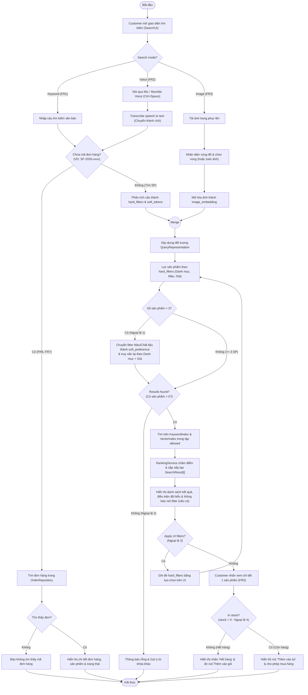

### 2.2. Activity Diagram 2 — Luồng AI Stylist Phối đồ & Thử đồ trực tiếp Wearson AI (`FR13`, `FR14`)

```mermaid
flowchart TD
    StartStylist([Bắt đầu]) --> OpenStudio["Customer mở trang AI Stylist & Phối đồ"]
    OpenStudio --> CaptureBody["Chụp ảnh trực tiếp qua Camera hoặc tải ảnh toàn thân"]
    CaptureBody --> AnalyzeBody["Phân tích vóc dáng (Body Shape) & tông da từ ảnh"]
    AnalyzeBody --> InputDecision{"Chọn cách nhập mong muốn?"}

    %% Nhánh 1: 3-4 câu hỏi mẫu
    InputDecision -- "Hướng 1: Trắc nghiệm có mẫu" --> AnswerQuiz["Trả lời 4 câu hỏi mẫu:\n1. Dịp mặc  2. Phong cách\n3. Ưu tiên dáng  4. Ngân sách & Màu"]
    AnswerQuiz --> MergePref(("Merge"))

    %% Nhánh 2: Bật Mic nói (Mumble Voice)
    InputDecision -- "Hướng 2: Bật Mic nói" --> RecordVoice["Bật Mic / Giữ Ctrl+Space nói mong muốn tiếng Việt"]
    RecordVoice --> SpeechToText["Chuyển giọng nói thành văn bản (Transcript)"]
    SpeechToText --> ParseVoicePref["Tách các tiêu chí (Dịp, Phong cách, Dáng, Ngân sách)"]
    ParseVoicePref --> MergePref

    %% Hội tụ & Phối nhiều bộ Costume
    MergePref --> BuildStylistReq["Tạo hồ sơ yêu cầu phối đồ (StylistSession)"]
    BuildStylistReq --> MixOutfits["CostumeMixerService chọn sản phẩm còn hàng trong shop\nphối thành 3 bộ Costume (Áo + Quần/Váy + Khoác/Phụ kiện)"]
    MixOutfits --> RankOutfits["Chấm điểm độ hợp dáng & tạo lời giải thích cho từng bộ"]
    RankOutfits --> ShowCostumes["Hiển thị 3 bộ Costume hoàn chỉnh trên giao diện"]

    ShowCostumes --> TryOnChoice{"Chọn thử đồ trực tiếp?"}
    TryOnChoice -- "Có (FR14: Wearson AI)" --> RunWearson["Đẩy ảnh khách hàng + Bộ Costume sang WearsonTryOnService"]
    RunWearson --> DisplayPreview["Hiển thị hình ảnh khách hàng đang mặc bộ Costume đó"]
    DisplayPreview --> BuyChoice{"Thêm cả bộ vào giỏ?"}
    TryOnChoice -- "Không" --> BuyChoice

    BuyChoice -- "Có" --> BatchAddCart["Thêm toàn bộ sản phẩm của bộ Costume vào Giỏ hàng"] --> EndStylist([Kết thúc])
    BuyChoice -- "Đổi bộ khác" --> ShowCostumes
```

---

## 3. Trích xuất Lớp Thực thể (5 Bước chuẩn `tt_nhichu.pdf` trang 18–20)

### Bước 1: Mô tả nghiệp vụ trong một đoạn văn ngắn
> **Khách hàng** tìm **sản phẩm** bằng cách gõ chữ, nói hoặc tải **ảnh** lên, hoặc chụp **ảnh cá nhân** kèm câu trả lời/lời nói để hệ thống gợi ý các **bộ trang phục (Costume)** và **mặc thử trực tiếp**. Khi tìm kiếm, **hệ thống** giữ các sản phẩm đúng **danh mục**, **màu sắc** và **mức giá** khách nêu (nếu dưới 3 kết quả thì nới lỏng màu sắc), rồi trả về **danh sách kết quả** gồm các **kết quả** mang **thứ hạng** và **nhãn giải thích**. Mỗi sản phẩm thuộc một **danh mục** (danh mục có thể nằm trong **danh mục lớn hơn**), có **tên**, **giá**, **mô tả**, **lượt bán**, **điểm đánh giá** và các **biến thể** theo **màu**, **kích cỡ**, **tồn kho**. Mỗi **lượt tìm kiếm** và mỗi **phiên tư vấn phối đồ** được lưu lại. Khách hàng có thể thêm sản phẩm hoặc cả **bộ trang phục** vào **giỏ hàng**, tiến hành đặt **đơn hàng** gồm các **dòng đơn hàng** và tra cứu **trạng thái đơn hàng**.

### Bước 2 & Bước 3: Phân loại danh từ vào 3 nhóm (Entity Class / Attribute / Loại bỏ)

| Nhóm 1: Entity Class (Lớp thực thể) | Nhóm 2: Attribute (Thuộc tính của lớp) | Nhóm 3: Loại bỏ (Lý do) |
|---|---|---|
| • Khách hàng & Quản trị viên $\rightarrow$ **`User`** (`Customer` / `Admin`) • Danh mục $\rightarrow$ **`Category`** • Sản phẩm $\rightarrow$ **`Product`** • Biến thể sản phẩm $\rightarrow$ **`ProductVariant`** • Lượt tìm kiếm $\rightarrow$ **`QueryRepresentation`** • Kết quả tìm kiếm $\rightarrow$ **`SearchResult`** • Phiên tư vấn phối đồ $\rightarrow$ **`StylistSession`** • Bộ trang phục $\rightarrow$ **`Outfit` (Costume)** • Món đồ trong bộ $\rightarrow$ **`OutfitItem`** • Phiên thử đồ ảo $\rightarrow$ **`TryOnSession`** • Đơn hàng $\rightarrow$ **`Order`** • Dòng đơn hàng $\rightarrow$ **`OrderItem`** | • Cách nhập $\rightarrow$ `modality` của `QueryRepresentation` • Danh mục, màu, giá khách nêu $\rightarrow$ `hardFilters`, `softTokens` của `QueryRepresentation` • Ảnh tìm kiếm $\rightarrow$ `imageEmbedding` của `QueryRepresentation` • Thứ hạng, điểm, nhãn giải thích $\rightarrow$ `rank`, `score`, `badges` của `SearchResult` • Ảnh cá nhân, dáng người, câu trả lời/lời nói $\rightarrow$ `userPhotoUrl`, `bodyShape`, `preferences` của `StylistSession` • Tên, giá gốc, mô tả, lượt bán, đánh giá $\rightarrow$ `name`, `basePrice`, `description`, `soldCount`, `rating` của `Product` • Màu, kích cỡ, tồn kho $\rightarrow$ `colorName`, `size`, `stockQuantity` của `ProductVariant` • Trạng thái đơn, tổng tiền $\rightarrow$ `orderStatus`, `totalAmount` của `Order` | • **Hệ thống:** quá chung, là toàn bộ phần mềm. • **Danh sách kết quả:** chỉ là tập hợp (`List`) các đối tượng `SearchResult`. • **Danh mục lớn hơn:** không phải lớp riêng, mà là quan hệ tự liên kết cha–con (`parent`) của chính lớp `Category`. |

### Bước 4: Xác định quan hệ số lượng (`1-1`, `1-n`, `n-n`)
- **Quan hệ `1-n`:**
  - `User (1) ── (0..*) QueryRepresentation`
  - `User (1) ── (0..*) StylistSession`
  - `User (1) ── (0..*) Order`
  - `Category cha (0..1) ── (0..*) Category con` (tự tham chiếu)
  - `Category (1) ── (0..*) Product`
  - `Product (1) ── (1..*) ProductVariant`
- **Quan hệ `n-n` (Tách bằng lớp thực thể trung gian):**
  - `QueryRepresentation` và `Product` có quan hệ `n-n` $\rightarrow$ Tách bằng lớp **`SearchResult`** (mang thuộc tính `rank`, `score`, `badges`).
  - `Outfit` (Bộ Costume) và `Product` có quan hệ `n-n` $\rightarrow$ Tách bằng lớp **`OutfitItem`** (mang thuộc tính `slotRole` như Áo/Quần/Khoác).
  - `Order` và `ProductVariant` có quan hệ `n-n` $\rightarrow$ Tách bằng lớp **`OrderItem`** (mang thuộc tính `quantity`, `unitPrice`).

### Bước 5: Xác định bản chất quan hệ đối tượng (Composition vs Association)
- **Composition (`◆──`):**
  - `QueryRepresentation (1) ◆── (0..*) SearchResult`: Thứ hạng `rank` chỉ có ý nghĩa trong đúng lượt tìm kiếm đó.
  - `Product (1) ◆── (1..*) ProductVariant`: Biến thể màu/size thuộc sở hữu của sản phẩm.
  - `Outfit (1) ◆── (2..*) OutfitItem`: Các thành phần phối đồ gắn chặt với bộ Costume.
  - `Order (1) ◆── (1..*) OrderItem`: Dòng đơn hàng không tồn tại độc lập ngoài đơn hàng.
- **Association (`───`):**
  - `SearchResult (0..*) ─── (1) Product`
  - `OutfitItem (0..*) ─── (1) Product`
  - `StylistSession (1) ─── (1..*) Outfit`
  - `Product (0..*) ─── (1) Category`

---

## 4. Biểu đồ Lớp Phân tích (Analysis Class Diagram)

### 4.1. Sơ đồ Entity Classes ở mức Phân tích (Chỉ mang ý nghĩa nghiệp vụ)

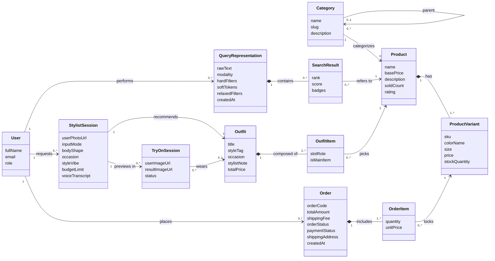

### 4.2. Bảng View Classes (`in` / `out` / `sub`) và Control Classes (Chuẩn trang 22 `tt_nhichu.pdf`)

Quy ước ký hiệu phần tử giao diện của PTIT:
- **`in...`**: Phần tử nhận dữ liệu đầu vào từ Actor (ô text, micro, file ảnh, nút radio câu hỏi).
- **`out...`**: Phần tử hiển thị kết quả ra màn hình.
- **`sub...`**: Nút bấm hoặc đường link kích hoạt sự kiện gửi yêu cầu (`actionPerformed`).

| View Class (Lớp giao diện) | Các phần tử thành phần (`in` / `out` / `sub`) |
|---|---|
| **`SearchUI`** | • `inQuery`: Ô nhập từ khóa hoặc mã đơn hàng • `subSearch`: Nút bấm Tìm kiếm |
| **`VoiceInput`** | • `inVoice`: Lời nói tiếng Việt thu từ micro / Mumble Voice (`Ctrl+Space`) • `outTranscript`: Văn bản phiên âm hiển thị trực tiếp • `subMic`: Nút bật/tắt thu âm |
| **`ImageUpload`** | • `inImage`: File ảnh trang phục tải lên • `inSelectedBox`: Vùng trang phục được chọn trên ảnh (`BoundingBox`) • `subUpload`: Nút tải ảnh & xác nhận vùng chọn |
| **`SearchResultView`** | • `outFilters`: Các điều kiện hệ thống đã hiểu (Danh mục, Màu, Giá) • `outRelaxedNotice`: Thông báo khi bộ lọc được nới lỏng (do `< 3` kết quả) • `outResults`: Danh sách sản phẩm kèm thứ hạng & nhãn giải thích • `subFilter`: Bộ lọc giao diện (Size, Giá, Sắp xếp) • `subProduct`: Link nhấn vào xem chi tiết sản phẩm |
| **`StylistStudioUI`** | • `inBodyPhoto`: Ảnh chụp trực tiếp từ Webcam hoặc ảnh toàn thân tải lên • `inQuizAnswers`: Các phương án trả lời cho 4 câu hỏi mẫu (Dịp, Phong cách, Dáng, Ngân sách) • `inVoicePrompt`: Lời nói mô tả mong muốn qua Mumble Voice • `outBodyAnalysis`: Kết quả phân tích dáng người & tông da • `outCostumes`: Danh sách 2–3 bộ Costume được phối kèm lời khuyên của AI Stylist • `subGenerateCostumes`: Nút bấm Phân tích & Phối đồ • `subTryOnCostume`: Nút bấm Ướm thử bộ đồ với Wearson AI • `subAddCostume`: Nút thêm nguyên bộ Costume vào giỏ hàng |
| **`TryOnPreviewView`** | • `outPreviewImage`: Hình ảnh người dùng đang mặc bộ Costume do Wearson AI tạo ra • `subCompare`: Nút chuyển đổi xem ảnh gốc / ảnh mặc thử |
| **`OrderLookupView`** | • `outOrderInfo`: Thông tin mã đơn, trạng thái, ngày đặt, tổng tiền • `outOrderItems`: Danh sách các sản phẩm trong đơn hàng |
| **`AdminDashboardUI`** | • `inProductForm`, `inCategoryForm`, `inOrderStatus`: Các ô nhập liệu quản trị • `outMetrics`, `outInventoryTable`, `outOrderList`: Bảng dữ liệu quản trị • `subSaveProduct`, `subSaveCategory`, `subUpdateOrder`: Các nút lưu thay đổi |

### 4.3. Bảng 4 Câu hỏi Gán Trách nhiệm Hàm (Method Assignment Table — Trang 22 `tt_nhichu.pdf`)

| Câu hỏi | Chức năng 1: Tìm sản phẩm (`FR1–FR4`) | Chức năng 2: Tư vấn & Phối Costume (`FR13`) | Chức năng 3: Thử đồ Wearson AI (`FR14`) | Chức năng 4: Xem chi tiết SP (`FR5`) | Chức năng 5: Tra cứu đơn hàng (`FR6–FR7`) |
|---|---|---|---|---|---|
| **1. Tên method?** | `search` | `recommendCostumes` | `tryOnCostume` | `get` | `findByCode` |
| **2. Input?** | Nội dung chữ/giọng nói, file ảnh, vùng chọn, `modality` | Ảnh cơ thể, câu trả lời 4 câu hỏi mẫu hoặc câu nói từ mic | Ảnh cơ thể khách, mã bộ `Outfit` (hoặc `variantId`) | Mã sản phẩm (`productId`) | Mã đơn hàng (`orderCode`) |
| **3. Output?** | Danh sách `SearchResult[]` & trạng thái nới filter | Hồ sơ dáng người & Danh sách `Outfit[]` (2–3 bộ Costume) | Đối tượng `TryOnSession` chứa `resultImageUrl` | Đối tượng `Product` | Đối tượng `Order` |
| **4. Class chứa?** | Việc tìm kiếm phối hợp nhiều bước nên đặt tại lớp điều phối **`SearchOrchestrator`** (nhận yêu cầu từ `SearchController`) | Việc phân tích dáng, hiểu ý định và ghép nhiều món đồ phức tạp nên đặt tại **`StylistOrchestrator`** (nhận từ `StylistController`) | Việc ghép ảnh trang phục lên người dùng đặt tại **`WearsonTryOnService`** | Output là thực thể `Product`, đặt tại **`ProductRepository.get`** | Output là thực thể `Order`, đặt tại **`OrderRepository.findByCode`** |

---

## 5. Biểu đồ Tuần tự Phân tích (Analysis Sequence Diagrams)

### 5.1. Analysis Sequence Diagram 1 — Tìm kiếm sản phẩm (Text / Voice / Image)

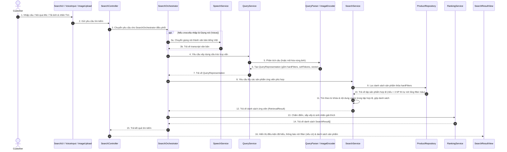

### 5.2. Analysis Sequence Diagram 2 — AI Stylist Phối nhiều Costume & Thử đồ Wearson AI

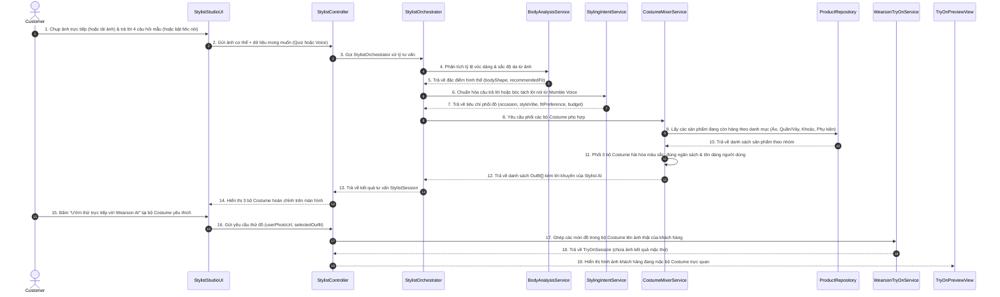

---

# PHẦN III: THIẾT KẾ HỆ THỐNG (SYSTEM DESIGN)

## 1. Kiến trúc 3 Layer & Package Diagram (Chuẩn trang 25–30 `tt_nhichu.pdf`)

### 1.1. Ba Layer và Trách nhiệm
Hệ thống tuân thủ nghiêm ngặt kiến trúc 3 tầng, **dependency chỉ đi một chiều từ trên xuống**, tầng `Presentation` tuyệt đối không gọi tắt xuống tầng `Data`:
1. **Presentation Layer:** Tiếp nhận thao tác của `Customer` và `Admin`, hiển thị kết quả (`SearchUI`, `VoiceInput`, `ImageUpload`, `SearchResultView`, `StylistStudioUI`, `TryOnPreviewView`, `OrderLookupView`, `AdminDashboardUI`, `SearchController`, `StylistController`, `AdminController`).
2. **Application Layer:** Điều phối luồng nghiệp vụ, phân tích câu truy vấn, nhận diện dáng người, phối các bộ Costume, sắp xếp thứ hạng và gọi ghép ảnh thử đồ (`SearchOrchestrator`, `StylistOrchestrator`, `SpeechService`, `QueryService`, `ImageService`, `SearchService`, `RankingService`, `BodyAnalysisService`, `CostumeMixerService`, `WearsonTryOnService`).
3. **Data Layer:** Lưu trữ và truy cập cơ sở dữ liệu, chỉ mục từ khóa, chỉ mục vector và kho ảnh (`ProductRepository`, `OrderRepository`, `StylistRepository`, `VectorIndex`, `KeywordIndex`, `ImageStorage`).

### 1.2. Package Diagram (4 Packages chuẩn PTIT)

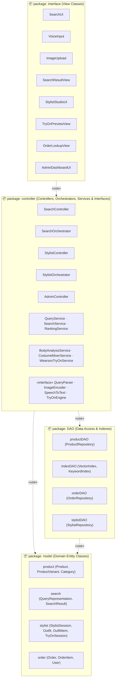

---

## 2. Thiết kế Entity Class (4 Bước chuẩn trang 31 `tt_nhichu.pdf`)

1. **Bước 1 — Thêm khóa định danh (`id`):**
   - `Product` có `productId : String`, `ProductVariant` có `variantId : String`, `Category` dùng `slug : String` (hoặc `categoryId : String`) làm khóa.
   - `QueryRepresentation`, `SearchResult`, `StylistSession`, `Outfit`, `OutfitItem`, `TryOnSession`, `Order`, `OrderItem` đều có `id : String` khi lưu xuống CSDL.
2. **Bước 2 — Thêm kiểu dữ liệu cho mọi Attribute:**
   - `basePrice : float`, `stockQuantity : int`, `imageEmbedding : float[]`, `textEmbedding : float[]`, `modality : Modality`, `hardFilters : Map<String, Object>`, `rank : int`, `score : float`, `badges : String[]`.
3. **Bước 3 — Chuyển Association thành Composition khi cần:**
   - `QueryRepresentation ◆── SearchResult`, `Outfit ◆── OutfitItem`, `Product ◆── ProductVariant`, `Order ◆── OrderItem`.
   - `Product ─── Category` giữ nguyên là Association vì `Category` tồn tại độc lập.
4. **Bước 4 — Thêm Attribute kiểu Object để giữ tham chiếu đối tượng liên quan:**
   - `SearchResult` có thuộc tính `product : Product`.
   - `Outfit` có thuộc tính `items : OutfitItem[]`.
   - `OutfitItem` có thuộc tính `product : Product` và `variant : ProductVariant`.
   - `StylistSession` có thuộc tính `recommendedOutfits : Outfit[]`.

---

## 3. Thiết kế Cơ sở Dữ liệu (5 Bước) & Biểu đồ ERD (Chuẩn trang 32–33 `tt_nhichu.pdf`)

### 3.1. Năm bước chuyển từ Entity Class sang Database Tables
1. **Bước 1 (Mỗi Entity Class thành một Table):** `users`, `categories`, `products`, `product_variants`, `query_representations`, `search_results`, `stylist_sessions`, `outfits`, `outfit_items`, `tryon_sessions`, `orders`, `order_items`.
2. **Bước 2 (Attribute nguyên thủy thành Cột):** Ví dụ bảng `products` có các cột `name`, `base_price`, `description`, `sold_count`, `rating`, `image_url`, `text_embedding`, `image_embedding`.
3. **Bước 3 (Biểu diễn quan hệ):**
   - `Category – Product` là `1-n` $\rightarrow$ Giữ 2 bảng.
   - `QueryRepresentation – Product` là `n-n` $\rightarrow$ Có bảng trung gian `search_results`.
   - `Outfit – Product` là `n-n` $\rightarrow$ Có bảng trung gian `outfit_items`.
4. **Bước 4 (Khóa chính & Khóa ngoại):** `id` thành `PRIMARY KEY`. Phía `n` giữ `FOREIGN KEY`: `category_id` trong `products`, `parent_id` trong `categories` (tự tham chiếu cha-con), `query_id` và `product_id` trong `search_results`, `outfit_id` và `product_id` trong `outfit_items`.
5. **Bước 5 (Loại bỏ dữ liệu dư thừa):** Bảng `search_results` không chép lại tên hay giá sản phẩm mà chỉ giữ `product_id`, `rank`, `score` và `badges`.

### 3.2. Sơ đồ ERD Hoàn chỉnh

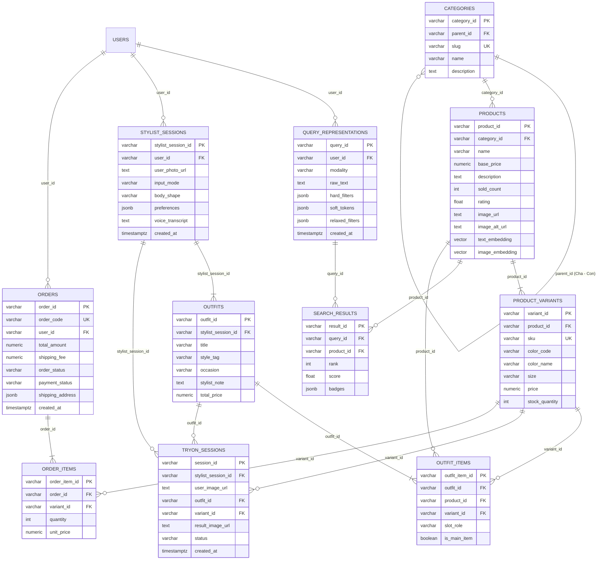

---

## 4. Biểu đồ Lớp Thiết kế (Design Class Diagrams — Chuẩn trang 34–36 `tt_nhichu.pdf`)

### 4.1. Design Class Diagram 1 — Package `interface` và `controller`
`SearchController` chỉ gọi một hàm điều phối `SearchOrchestrator.search()`, và `StylistController` gọi `StylistOrchestrator.recommendCostumes()`:

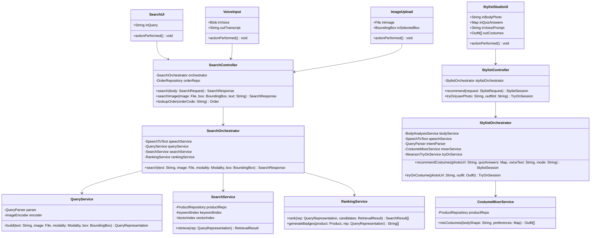

### 4.2. Design Class Diagram 2 — Package `DAO`, `model` & Realization (`Interface` $\triangleleft$.. `Implementation`)
Các thành phần dễ thay đổi (AI Parser, Image Encoder, Speech-to-Text, Try-On Engine, Repository) đều được đặt sau **Interface** (theo chuẩn trang 35–36 `tt_nhichu.pdf`):

```mermaid
classDiagram
    direction TB

    class QueryParser {
        <<interface>>
        +parse(text: String) ParsedIntent
    }
    class RuleQueryParser {
        +parse(text: String) ParsedIntent
    }
    class LlmQueryParser {
        +parse(text: String) ParsedIntent
    }

    class ImageEncoder {
        <<interface>>
        +detectObjects(image: File) BoundingBox[]
        +encode(image: File, box: BoundingBox) float[]
    }
    class ColorHistogramEncoder {
        +detectObjects(image: File) BoundingBox[]
        +encode(image: File, box: BoundingBox) float[]
    }
    class ClipImageEncoder {
        +detectObjects(image: File) BoundingBox[]
        +encode(image: File, box: BoundingBox) float[]
    }

    class SpeechToText {
        <<interface>>
        +transcribe(audio: Blob, langHint: String) String
    }
    class MumbleVoiceAdapter {
        +String hotkey
        +transcribe(audio: Blob, langHint: String) String
    }
    class WebSpeechAdapter {
        +transcribe(audio: Blob, langHint: String) String
    }

    class TryOnEngine {
        <<interface>>
        +synthesize(userPhoto: String, garments: Product[]) String
    }
    class WearsonTryOnAdapter {
        +synthesize(userPhoto: String, garments: Product[]) String
    }

    class ProductRepository {
        <<interface>>
        +get(id: String) Product
        +findIds(hardFilters: Map) String[]
        +subtreeSlugs(slug: String) String[]
        +save(product: Product) Product
    }
    class JsonProductRepository {
        +get(id: String) Product
        +findIds(hardFilters: Map) String[]
        +subtreeSlugs(slug: String) String[]
        +save(product: Product) Product
    }
    class PostgresProductRepository {
        +get(id: String) Product
        +findIds(hardFilters: Map) String[]
        +subtreeSlugs(slug: String) String[]
        +save(product: Product) Product
    }

    class VectorIndex {
        +add(ids: String[], vectors: float[][]) void
        +search(vector: float[], k: int, allowedIds: String[]) Map~String,Float~
    }

    class KeywordIndex {
        +build(docs: Product[]) void
        +search(tokens: String[], k: int, allowedIds: String[]) Map~String,Float~
    }

    QueryParser <|.. RuleQueryParser
    QueryParser <|.. LlmQueryParser
    ImageEncoder <|.. ColorHistogramEncoder
    ImageEncoder <|.. ClipImageEncoder
    SpeechToText <|.. MumbleVoiceAdapter
    SpeechToText <|.. WebSpeechAdapter
    TryOnEngine <|.. WearsonTryOnAdapter
    ProductRepository <|.. JsonProductRepository
    ProductRepository <|.. PostgresProductRepository
```

---

## 5. Biểu đồ Tuần tự Thiết kế (Design Sequence Diagrams — Chuẩn trang 37–39 `tt_nhichu.pdf`)

### 5.1. Design Sequence Diagram 1 — Luồng Tìm kiếm Đa phương thức (Build Query $\rightarrow$ Retrieve với `allowed` & Nới lỏng filter $\rightarrow$ Rank)

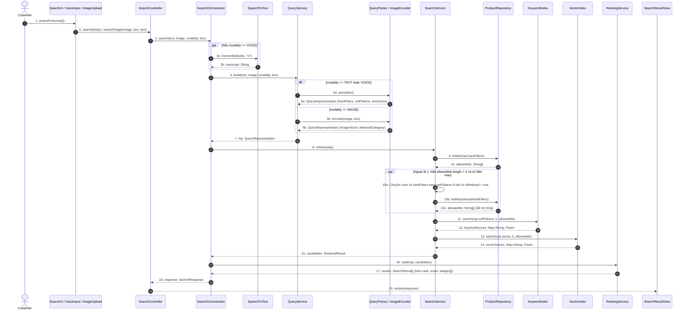

### 5.2. Design Sequence Diagram 2 — Luồng AI Stylist Phối nhiều Costume & Thử đồ Wearson AI

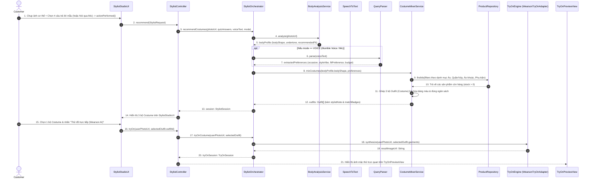

---

# PHẦN IV: MA TRẬN ÁNH XẠ THIẾT KẾ $\leftrightarrow$ CODE (TRACEABILITY MATRIX)

Khi bạn xác nhận **Khóa Draft (Lock)**, mã nguồn trong dự án sẽ được tổ chức theo đúng 4 Package trong bản thiết kế này:

| Package trong Thiết kế | Đường dẫn trong Code (`apps/web/src/`) | Các Class / Interface bên trong (Khớp 100% tên & hàm) |
|---|---|---|
| **`model`** | `src/domain/models.ts` | `User`, `Category`, `Product`, `ProductVariant`, `QueryRepresentation`, `SearchResult`, `StylistSession`, `Outfit`, `OutfitItem`, `TryOnSession`, `Order`, `OrderItem`, `BoundingBox`, `Modality`. |
| **`DAO`** | `src/dao/repositories.ts` `src/dao/indexes.ts` | • `ProductRepository` (Interface) & `JsonProductRepository` (`get`, `findIds`, `subtreeSlugs`, `save`) • `OrderRepository` (`findByCode`, `listAll`, `create`, `updateStatus`) • `VectorIndex` (`add`, `search(vector, k, allowedIds)`) • `KeywordIndex` (`build`, `search(tokens, k, allowedIds)`) |
| **`controller`** | `src/services/interfaces.ts` `src/services/search-orchestrator.ts` `src/services/stylist-orchestrator.ts` | • Interfaces: `QueryParser`, `ImageEncoder`, `SpeechToText`, `TryOnEngine` • Implementations: `RuleQueryParser`, `ColorHistogramEncoder`, `MumbleVoiceAdapter`, `WebSpeechAdapter`, `WearsonTryOnAdapter` • Services & Orchestrators: `SearchController`, `SearchOrchestrator`, `QueryService`, `SearchService`, `RankingService`, `StylistController`, `StylistOrchestrator`, `BodyAnalysisService`, `CostumeMixerService`. |
| **`interface` (View)** | `src/components/search-rail.tsx` `src/components/shop-catalog.tsx` `src/app/outfits/page.tsx` `src/app/try-on/page.tsx` `src/app/admin/page.tsx` | • `SearchUI`, `VoiceInput` (hỗ trợ Mumble Voice `Ctrl+Space` & Web Speech), `ImageUpload` (kèm chọn vùng `BoundingBox`) • `SearchResultView` (hiển thị `outFilters`, `outRelaxedNotice` khi nới filter, `badges`) • `OrderLookupView` (hiển thị ngay đơn hàng khi gõ mã đơn `SF-...` vào ô tìm kiếm) • `StylistStudioUI` & `TryOnPreviewView` (Chụp webcam trực tiếp + 4 câu hỏi mẫu hoặc Mic Mumble Voice $\rightarrow$ Phối 3 bộ Costume $\rightarrow$ Ướm thử trực tiếp với Wearson AI) • `AdminDashboardUI` (`Manage Product`, `Manage Category`, `Manage Order`). |
